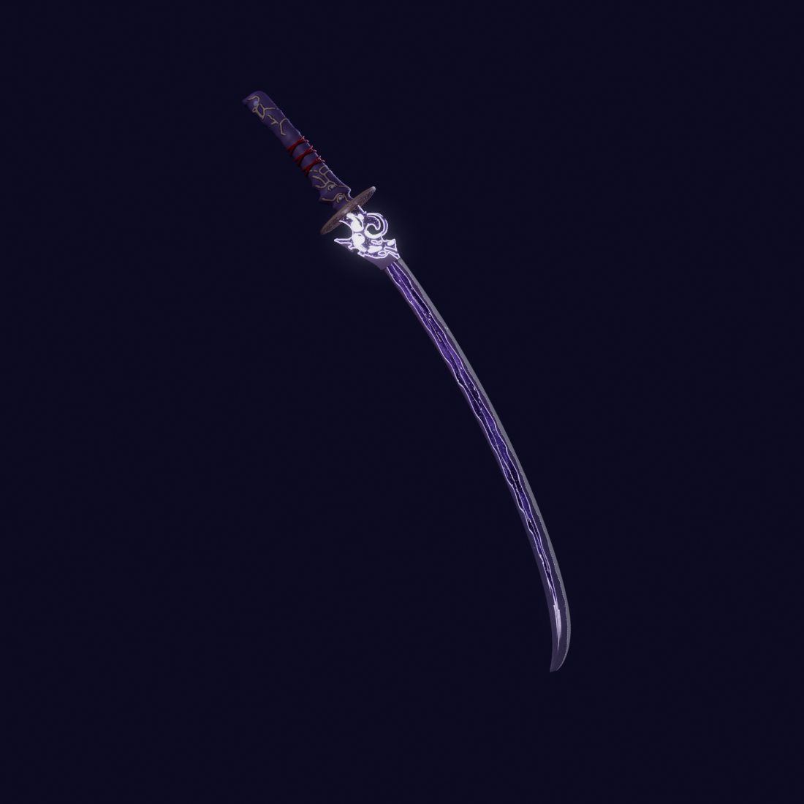
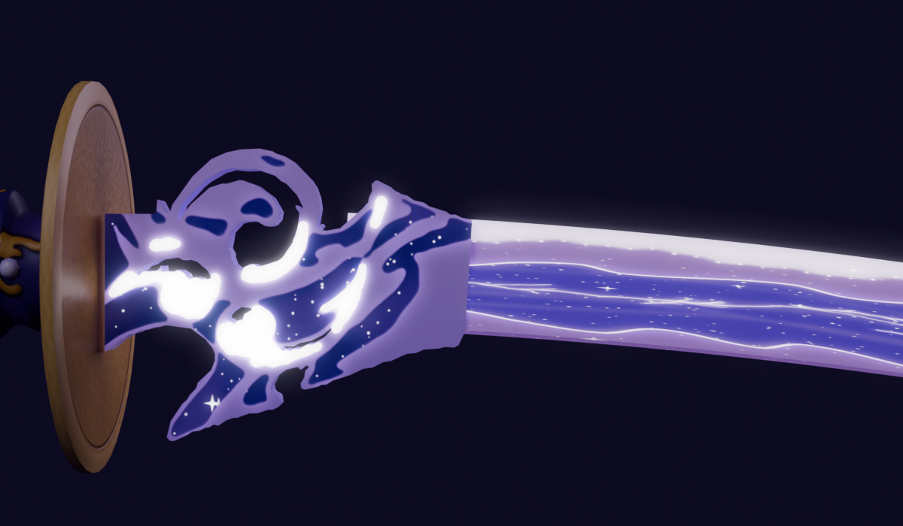
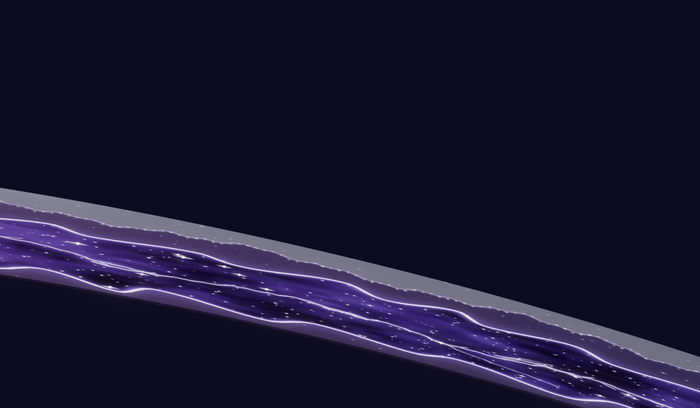
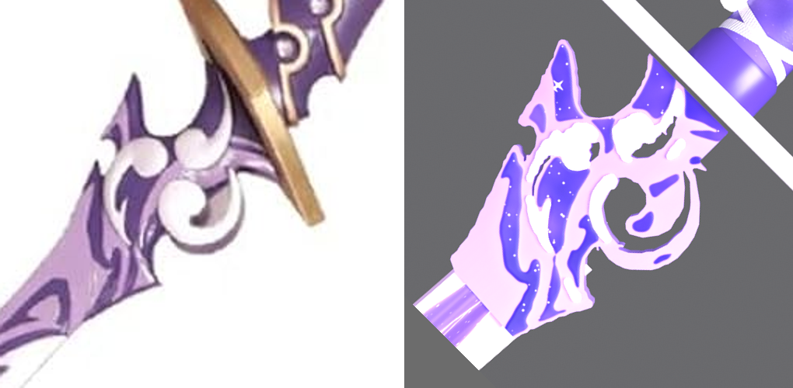
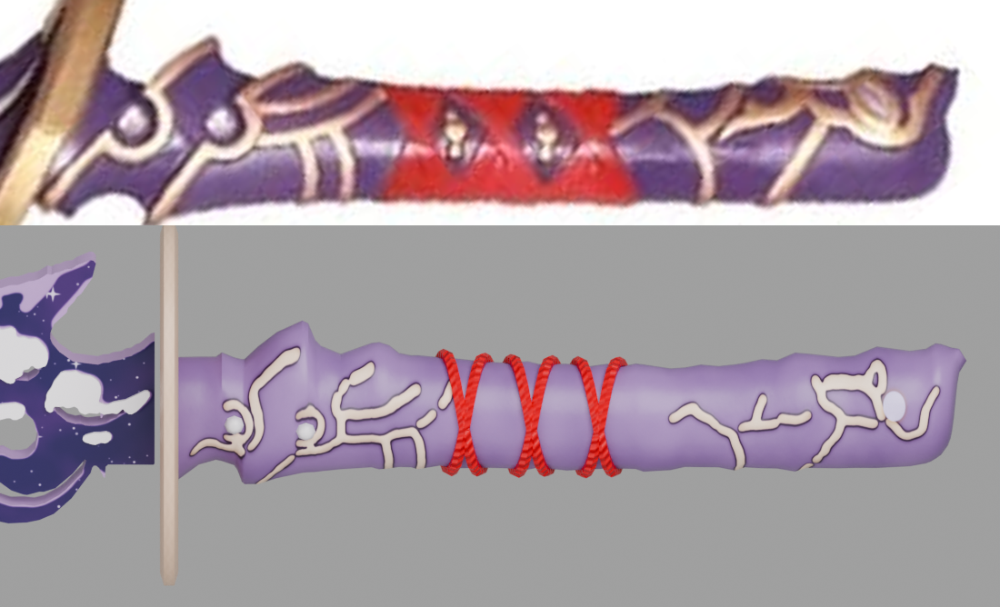
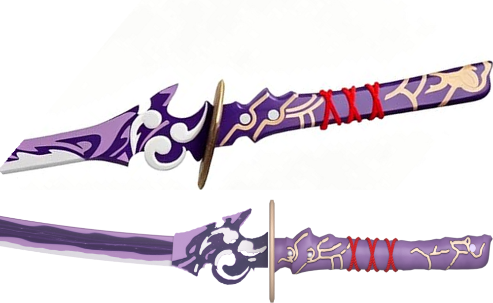
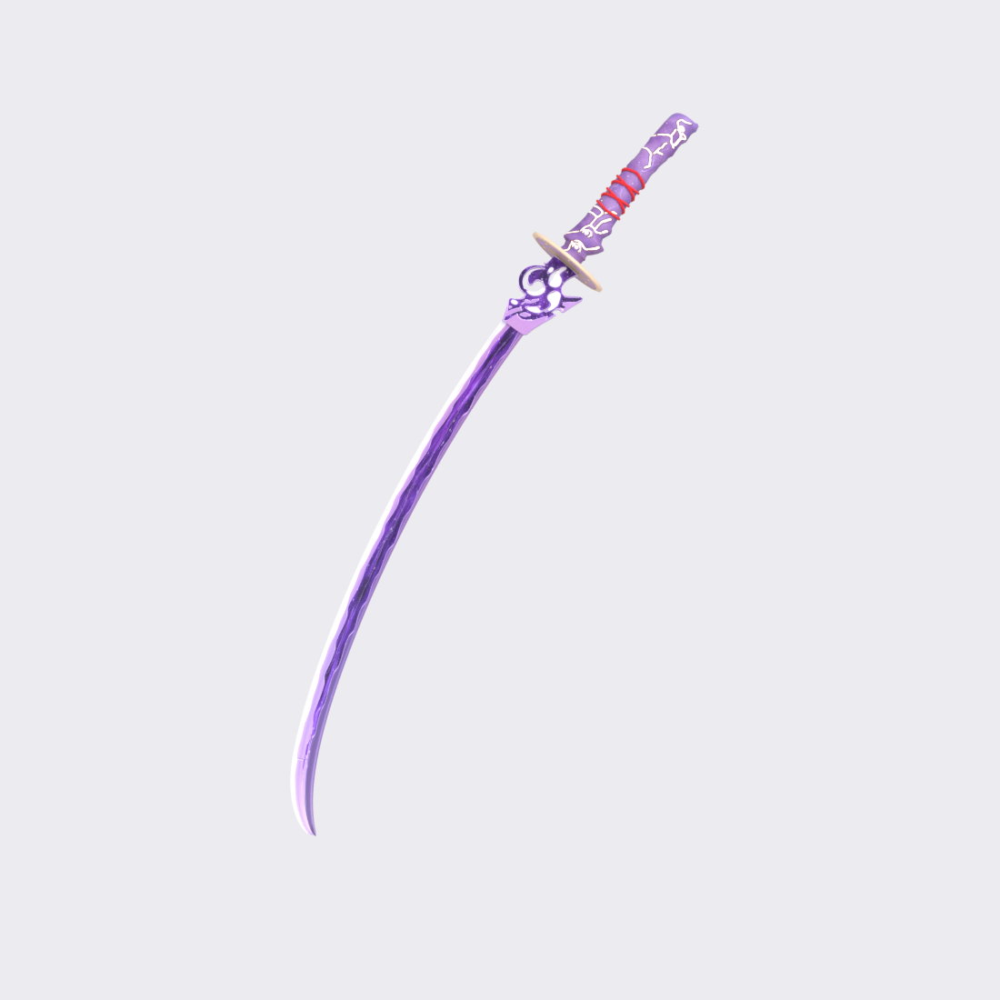
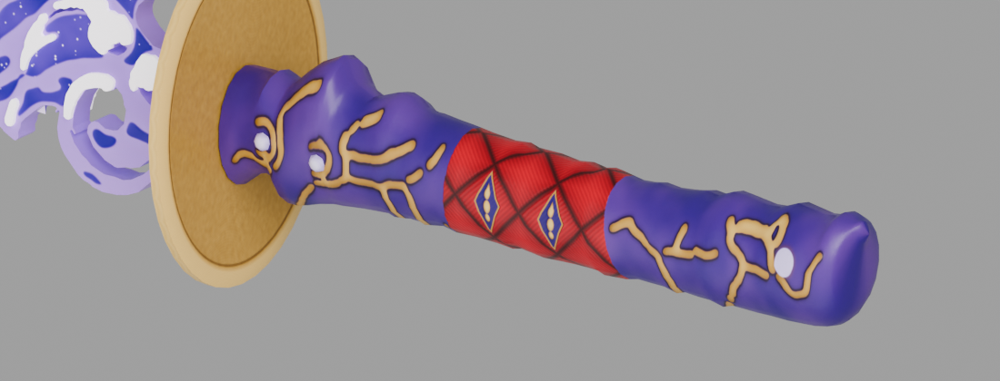
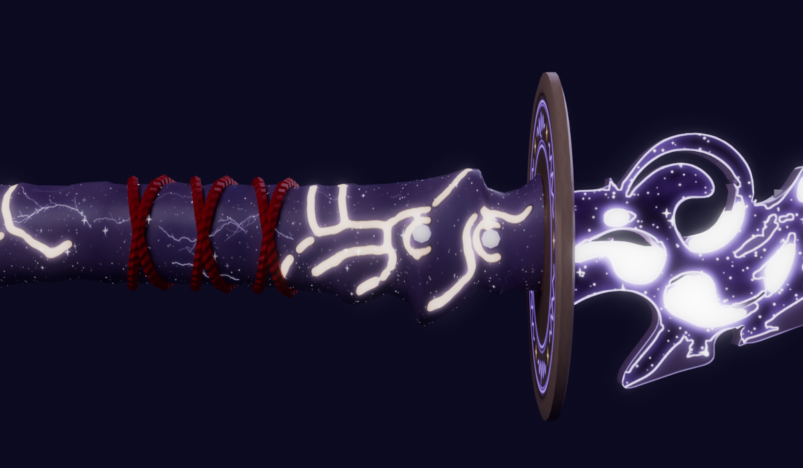

# 刀 (VRChat 用 / 夢想の一太刀 風・ファンメイド)

原神の雷電将軍が元素爆発で使う刀をもとにした、アバターに持たせる刀のモデルです。
参考画像を見ながら独自に作ったファンメイドのモデルです。個人で楽しむ範囲で使ってください (販売・配布はしないでください)。

暗い場所での見え方 (光のにじみ = ブルームありのワールドを想定):

鍔まわりと刀身 (同じくブルームあり):

刃の付け根の飾り (左: 参考画像 / 右: モデル。参考画像の輪郭をなぞって再現):

柄の金の線 (上: 金の線をなぞった前の写真を柄に沿ってまっすぐにしたもの / 下: モデル。写真と同じ向きから。柄巻きは今の写真に合わせて赤い紐に変えています):

色と飾り板・赤い紐の比較 (上: 参考画像の写真 / 下: モデル。光らせずに白い背景で):

明るい場所での見え方 (ブルームなし):

金色の楕円の鍔と柄 (斜めから):

暗い場所での柄と鍔 (ブルームあり。金の線・稲妻・星・鍔の稲妻の象嵌が光る):

## 仕様

| 項目 | 内容 |
| --- | --- |
| 大きさ | 全長 約 1.0m (刃 80cm (峰に沿った長さ)・柄 24cm)。柄の長さと太さは参考画像の写真の比率 |
| 反り | 参考画像を測って再現: 根元から半ばまではゆるやか、先の 2 割で急に曲がる先反り。反りの深さは弦の約 7.9% |
| 刃 | 幅は切っ先近くまでほぼ一定 (3.2cm)、先 12% で細くとがる。薄紫に白く光る地、中央に炎のような紫の模様 (根元はとがって始まり、切っ先近くで炎のすじにほどける) |
| 刃の付け根 | 参考画像 (コスプレ用の刀の写真) の輪郭をなぞり、トゲの先などの角は残してなめらかな曲線に整えた飾り板: 峰側の大小 2 本のトゲ、鍔に接する首の三日月形、刃側に鉤のように巻いた張り出し、中の抜け 4 か所 (つながっていない部分は穴として開いている)。写真どおり白い巴のまわりと鍔側は濃い紫、薄い紫は刀身側の炎と外側のトゲだけ。その上に白く光る巴のかけら 6 つ (それぞれ離れた別の形、ふちはなめらか) |
| 鍔 | 参考画像の写真を測った金色の楕円 (11.2 × 8.4cm、厚み 5.5mm)。表と裏のふちが少し盛り上がる耳つき |
| 柄 | 参考画像の写真の輪郭を測った形: 鍔の近くに 2 枚の飾り板 (峰側に大小のトゲ、刃側に張り出し)、少し太くなる柄頭と峰側の小さな鉤。つやのある深い紫の地に、写真からなぞった金の線、中ほどに赤い紐 (立体。逆向きに巻いた 2 本で、表と裏に X 字の交差が 3 つずつ)、飾り板に白い丸い鋲 (表と裏に 2 つずつ)、柄頭の金の巻きの中に薄紫の楕円の象眼 |
| 向き | Unity で刃が上 (Y)、刃先が前 (+Z)。原点は鍔の中心 |
| 目印 | `Grip` (握る位置、柄の中央) / `Tip` (切っ先)。どちらも Katana の子の空オブジェクト |
| ポリゴン | 7,296 三角形 |
| マテリアル | 2 個: `Katana_Blade` (光る部分: 刃・付け根の飾り板・白い巴) / `Katana_Hilt` (鍔・柄・鋲・紐。金の線・稲妻・星・象嵌だけがほのかに光る) |
| テクスチャ | 3 枚 (色とノーマルは 8192×8192、発光は 4096×4096。2 つのマテリアルで共有、FBX には埋め込まず隣に置く): `Katana_Atlas.png` (色) / `Katana_Emission.png` (発光) / `Katana_Normal.png` (ノーマルマップ) |
| 色 | 参考画像 (コスプレ用の刀の写真) の色を部位ごとに測って合わせた配色: 刀身の地は灰みのある薄紫、模様と飾り板の濃い部分は深い紫、刃先は銀白、巴は少し灰みのある白、鍔はブロンズ寄りの金、柄は灰みのある赤紫、金の線は淡いシャンパン色、紐は赤 |
| 刀身 | 地は根元から切っ先へ真珠のように移ろう薄紫 (桜色寄り → 青み → 明るい切っ先)、鎬に沿った磨きの光の筋、やわらかな地肌の流れ。炎の形の模様の中は赤紫と青紫がゆらぐ星雲で、光る縁取り・枝分かれする稲妻・大小の星のきらめき。刃先は銀白の帯 (刃文) に淡い紫の匂と光る沸、その上に霞のような映り |
| 飾り板の質感 | 濃い紫は星雲と星屑。濃い紫の縁と飾り板の輪郭に、太さのそろった光る線。白い巴のまわりに紫の光。薄い紫は刀身の地とつながる真珠のような色 |
| 柄の質感 | 金の線は中央が明るく縁が濃い丸い線 (まわりに細い影)、紫の地に赤紫と青紫の星雲のゆらぎ、細い稲妻、星のきらめき。金の線の中央に磨いた光の筋ときらめき、赤い紐は撚りの細かい筋、鋲は真珠のような白 |
| 鍔の質感 | 同心円の細かい磨き目とごく細かい槌目、外側の耳は明るく磨いた金、耳の内側に細い溝。面に二重の彫り線と、輪に沿って走る 6 本の稲妻の象嵌 (刀身と同じ深い紫の漆)、稲妻の間に金の星 |
| 発光 | 昼は写真の色のまま、暗い所で幻想的に光る: 模様の中の星雲がほのかに紫に、模様と飾り板の縁取り・稲妻・星・刃文の匂と沸は強く、白い巴も白く光る。地はごくほのか。柄は金の線がやわらかな金色に、稲妻と星が白く光り、鋲は真珠のように淡く光る。鍔は稲妻の象嵌が紫に、星が金に光る |
| 凹凸 | ノーマルマップ: 柄の金の線の盛り上がり、紐の撚り、鍔の稲妻の象嵌のくぼみ、刀身の模様のなめらかな彫り込み、飾り板の濃い紫の彫り込み、鍔の槌目と溝 |
| 動作確認 | Blender 5.1.2 |

## ファイル

- `make_katana.py` … Blender で刀を作って FBX に書き出すスクリプト
- `make_katana_texture.py` … 3 枚のテクスチャを作るスクリプト (Pillow と numpy を使用)
- `Katana_Atlas.png` / `Katana_Emission.png` / `Katana_Normal.png` … 生成済みのテクスチャ
- `guard_tone.png` … 刃の付け根の飾り板の塗り分け (濃い紫・薄い紫・白)。形は前の写真からなぞり、濃い紫と薄い紫の配分は今の写真に合わせたもの。テクスチャを作り直すときに使う
- `handle_tone.png` … 柄の塗り分け (紫・金の線。参考画像の写真からなぞったもの)。テクスチャを作り直すときに使う
- `export/Katana.fbx` … 書き出し済みの FBX (Blender 5.1.2 で作成)

## Blender での使い方

1. `make_katana.py` と 3 枚のテクスチャ (`Katana_Atlas.png` / `Katana_Emission.png` / `Katana_Normal.png`) を同じフォルダに置く
2. Blender の **Scripting** タブ → **テキスト → 開く** で `make_katana.py` を開く
3. **▶ (スクリプト実行)** (Alt+P)
4. シーンに `Katana` / `Grip` / `Tip` ができ、`Katana.fbx` と 3 枚のテクスチャが書き出されます
   (.blend を保存していればそのフォルダ、未保存ならスクリプトのフォルダ)

大きさはスクリプト上部の `SCALE` (全体)、`BLADE_LEN` (刃の長さ)、`HANDLE_LEN` (柄の長さ)、
`CURVE_BASE` / `CURVE_TIP` (反り: 根元側 / 先の曲がりの角度)、`BLADE_W` (刃の幅) で変えられます。

## Unity に入れるとき

- FBX は「回転 0・スケール 1・1unit = 1m」で読み込まれる設定で書き出しています。
- `Katana.fbx` と 3 枚のテクスチャを同じフォルダに入れてください。
- `Katana_Normal.png` はテクスチャ設定の **Texture Type を Normal map** にしてください。
- lilToon の設定 (2 つのマテリアルとも):
  - メインカラー: `Katana_Atlas.png`
  - ノーマルマップ: 「ノーマルマップ」をオンにして `Katana_Normal.png`
  - 発光: 「発光」をオンにして、テクスチャに `Katana_Emission.png`、色は白。目安の明るさは `Katana_Blade` 1.5、`Katana_Hilt` 1.0
- 写真の色のまま見せたいときは発光の明るさを 1 以下に、幻想的に光らせたいときは 1.5〜2 くらいに上げてください (ブルームのあるワールドでは稲妻や星屑がにじんで光ります)。
- 色とノーマルマップは 8192×8192、発光は 4096×4096 です。Unity のテクスチャ設定の **Max Size を 8192** にすると最大の解像度で使えます。
  ただし VRChat ではテクスチャのメモリが大きくなり、パフォーマンスランクが下がります (8192 は 1 枚で約 85MB)。
  重いときは Max Size を下げてください (作り直しは不要です)。目安: 色 4096、ノーマル 4096、発光 2048。
